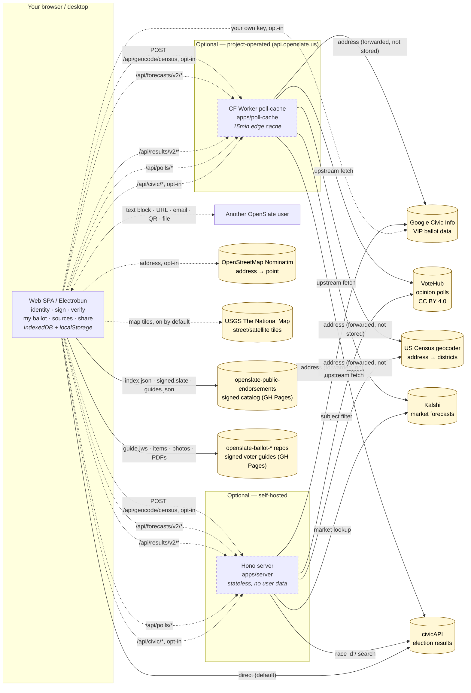

# OpenSlate

**An open standard and toolkit for sharing verifiable endorsements — and using
them to plan your own vote.**

> [!WARNING]
> **OpenSlate is alpha software, written by AI with a human watching over it.**
> While it's in alpha, things might be wrong, change, or break: the app, the
> data it shows, and the slate format itself ([SPEC.md](./SPEC.md) is still a
> draft). Check anything that matters, like who's on your ballot or what an
> endorser actually said, against your official voter guide and the original
> source. Found a problem? Come help:
> [open an issue](https://github.com/cinderblock/openslate/issues/new/choose),
> use *Send feedback* in the app, or send a pull request.

OpenSlate lets anyone publish a tamper-evident block of endorsements — for
candidates, races, ballot measures, or any option people vote on — and share it
over *any* medium (your website, a social post, an email). Each block is a single
line of text carrying an [Ed25519](https://ed25519.cr.yp.to/) signature, so
recipients can verify it hasn't been altered and who issued it, completely
offline. Individuals, organizations, and candidates can publish both **who they
endorsed** and **who endorsed them**.

On the receiving end, the web app lines up the endorsements of the sources
*you* follow, race by race, so you can see at a glance where the orgs and people
you trust agree and split on each contest, and make **your own picks** from
sources you can verify, alongside live polls, market forecasts, and (after polls
close) results.

The web app has two modes:

- **My vote** (the default): *My ballot* shows the races for your election and
  area: the official candidate list where one is imported, your followed
  sources' endorsements next to each choice, your private picks and notes, and
  what you've already signed. Work through it like an inbox: filter races by
  To do, Maybe, Picked or Against all, watch the "decided" count climb, and
  reach *ballot zero*. *One at a time* shows a single race and moves on once
  it's decided: number keys pick a choice, Shift+number rules it out, arrow
  keys step back and forth. *Quick fill* marks many races at once: pick (or rule
  out) every candidate of a party, or agree with, or go against, everything
  one source recommends, followed or not. It only fills what you haven't
  marked and can be undone. A race's own page compares every source's
  position and, where the catalog lists the election's official **voter
  guide** (the state's, or a county's for Congress, the Legislature and local
  races), shows it too: what the office does or what the measure would do,
  each candidate's photo and statement in their own words, what a Yes and a No
  vote mean, the arguments and rebuttals with who signed them (and, where a
  county prints them, paid arguments with who paid), the official summary and
  analysis, and the full text. That material is reference, not
  endorsement: it's never counted as anyone backing anything. *Sources* is
  where you follow sources, follow them to *disagree* (their picks count the
  other way on My ballot: what they back counts against it, what they oppose
  counts for it), or leave them imported just for comparison; browse the
  public catalog; and add slates from a link, file, QR code or paste. Each
  endorser shows its logo
  (from the catalog, else a monogram) and where it sits *left to right*: the
  share of its picks on the Democratic or the Republican side, counted only
  where the two parties split (races between a Democrat and a Republican, and
  races and measures the parties' endorsements disagree on). It's arithmetic
  on picks (`leanOf` in `@openslate/core`), not a rating; tap any meter for
  the counts. Where an official candidate list is imported, every source's
  choices are matched to it, so "Don Wagner" and the ballot's "Donald P. (Don)
  Wagner" are one candidate (by the list's `choice_id`, or by name: nicknames,
  middle initials). A name the list doesn't have is marked *Not on the
  ballot* (with the listed name it most resembles), and *Report it* sends a
  prefilled "wrong information" report; each imported catalog entry says how
  many of its names didn't match. Any candidate race takes a *write-in*: a
  name not printed on the ballot, signed as one, and flagged when the list
  doesn't certify it.
- **Publish**: create a signing identity, sign your My-ballot picks (plus any
  other race or issue, on your ballot or not) as a slate, see the slates you've
  signed, and verify or inspect any block.

A skippable getting-started guide sets up a first visit: pick an election,
where you vote, and whose recommendations you trust (or create an identity to
publish). Its first screen also says what OpenSlate is: alpha software
written by AI with a human watching over it, no account, open source, and how
to run your own copy instead of using the website (linking here). Reopen it
any time from *Get started* in the header. An *Alpha* badge beside the name
opens the same warning at the top of the page. On the public site
(openslate.us) that warning starts open, on every page, until you dismiss it,
and the welcome screen puts it first; a copy you run yourself keeps it to the
badge and one line on the welcome screen.

The guide works from the catalog's list alone: each entry says where its races
are, so the area and source steps are there at once, and only the lists you
pick are downloaded at the end (with the official ballot lists). Tick *Download
all* to fetch every organization's list instead, in one request, so the server
can't tell whose recommendations you use; the ones you didn't pick are kept
unfollowed, for comparison. With an older catalog that doesn't list races, the
guide reads every slate first, with a progress bar.

The goal: give citizens deeper insight into the things they care about, without
relying solely on simplified endorsements from a single newspaper or org.

## How to Run

OpenSlate is decentralized-first: signing and verifying always happen on your
machine, never on a server. The choice below is mostly about what fetches
*public* data (ballots, polls, results) on your behalf.

### Cloud

The easy path: open the hosted web app at **<https://openslate.us>**. Your
signing keys and slates live only in your browser; nothing is uploaded. Polls
and election results are fetched through project-operated Cloudflare Workers.
*Where you vote* fills itself in: pick your home on a map of California, or
use your device's location (both matched on your device, against district
boundaries shipped with the app), or type your address and pick who looks it
up: the US Census Bureau (through the project's relay, which keeps nothing),
OpenStreetMap (straight from your browser), or Google's Civic Information API.
Google answers with the contests on that address's ballot, two ways: with your
own Google API key (Settings → *Your Google API key*), straight from your
browser, so the address and the key go only to Google; or through the
project's relay, which asks Google with the project's key and keeps nothing.
Each address service asks before its first use and can be switched off in
Settings. The Elections page lists Google's elections the same way. The map lays the
districts over a street (or satellite) map from the US Geological Survey;
loading map images shows USGS roughly where you're looking, so the map says
so and can switch the background off. A district with no race
this election (e.g. an odd-numbered State Senate seat in 2026) says so on My
ballot. The lookups also find your school districts, so a county's school
board races show only for the school districts you're in; races only part of a
county votes on that the app can't place (a water district's division, a
school board's trustee area) are listed apart, as *Might be on your ballot*.
Or skip all that and choose your city and district numbers from lists
yourself. The app is light or dark to match your device; Settings →
Appearance picks one for this browser instead.

### Your Own Servers

Two pieces you can run yourself: the **static web app** (`apps/web`) and one
or more **optional backends** for ballot lookup, polls, and results. See
[Hosting topologies](#hosting-topologies) below for the architectural view.

#### Cloud (Cloudflare)

```sh
bun install
bun run build                                      # → apps/web/dist
bun run --filter '@openslate/poll-cache' deploy    # → Cloudflare Workers
```

Deploy `apps/web/dist` to Cloudflare Pages (or any static host: GitHub Pages,
Netlify, Vercel, plain S3). Build the SPA pointed at your own Worker:

```sh
VITE_POLLS_BASE=https://api.yourdomain.dev \
VITE_RESULTS_BASE=https://api.yourdomain.dev \
VITE_FORECASTS_BASE=https://api.yourdomain.dev \
bun run build
```

#### Bare

Run it all locally — your laptop, a VM, a Raspberry Pi, anything with
[Bun](https://bun.sh):

```sh
bun install
bun run dev:web      # Vite SPA       — http://localhost:5173
bun run dev:server   # Hono backend   — http://localhost:8787 (optional)
```

The backend also relays the Census address lookup (`POST /api/geocode/census`)
and, with a Google key, Google's Civic Information API (`GET
/api/civic/elections`, `POST /api/civic/voterinfo`): the same routes as the
public Worker. To turn on Google through your server, copy `.env.example` →
`.env` and set `GOOGLE_API_KEY`. (Anyone can also use their own key straight
from the browser, with no server: Settings → *Your Google API key*.) Vite proxies `/api` → `localhost:8787` so the SPA finds the
backend automatically.

The district boundaries (`apps/web/public/geo/us-ca.topo.json`, ~1 MB
gzipped with school districts, fetched only when someone opens the finder) are built from Census
TIGERweb by `bun run --filter '@openslate/web' geo`; rerun it after
redistricting.

The same install gets you the CLI, for scripting or headless workflows:

```sh
# generate a keypair (keep me.identity.json secret)
bun run --filter '@openslate/cli' start -- keygen --name "Me" -o me.identity.json

# sign a set of positions
bun run --filter '@openslate/cli' start -- sign positions.json --key me.identity.json

# verify a block someone shared
bun run --filter '@openslate/cli' start -- verify "<paste block>"

# take on another slate's positions: copy them, or adopt them by reference
# (a live link, or with an embedded snapshot); see SPEC §3.10
bun run --filter '@openslate/cli' start -- adopt https://example.org/party.slate \
  --mode reference --match "Governor,Proposition" --into positions.json
```

Other useful scripts: `bun test`, `bun run typecheck`, `bun run schema`
(emits `packages/core/schema/openslate.schema.json`), `bun run lint`.

### Desktop

An [Electrobun](https://blackboard.sh/electrobun) wrapper around the web build
lives in [`apps/desktop`](./apps/desktop). Currently a stub — prebuilt
binaries are not yet published. To run from source:

```sh
bun install
bun run --filter '@openslate/desktop' dev
```

## How it works

A **slate** is a [JWS-compact](https://www.rfc-editor.org/rfc/rfc7515) token:

```
base64url(header) . base64url(payload) . base64url(signature)
```

- The **payload** is canonical JSON ([RFC 8785 JCS](https://www.rfc-editor.org/rfc/rfc8785))
  listing your positions (`endorse`, `oppose`, `lean_for`, `lean_against`,
  `neutral`, `abstain`) with optional free-text statements.
- The **signature** is Ed25519 (EdDSA / [RFC 8037](https://www.rfc-editor.org/rfc/rfc8037)).
- Your **public key is your identity** (`ed25519:<base58>`); real-world trust is a
  separate, optional layer (e.g. domain attestation via `/.well-known/openslate.json`).
- Stored as a `.slate` file or transmitted with media type `application/openslate+jws`.

See **[SPEC.md](./SPEC.md)** for the normative format, **[`vectors/`](./vectors/)**
for cross-language conformance test vectors, and
**[`docs/PORTING.md`](./docs/PORTING.md)** to reimplement the format in another
language. The standard is decentralized-first: a block is self-contained and
verifiable without any server.

A **voter guide** carries an election authority's official material (candidate
statements and photos, a measure's summary, analysis, arguments and full text)
rather than positions, so it isn't a slate. It is one signed manifest
(`typ: openslate-guide+jws`, the same canonical JSON and Ed25519) listing every
published file with its SHA-256; clients fetch only the files a page needs and
check each one. `openslate guide check|sign|verify` builds and checks one. The
format lives in [`packages/core/src/guide.ts`](./packages/core/src/guide.ts) and
isn't part of SPEC.md yet. California's Nov 3, 2026 guides (the state's, and
San Francisco's pamphlet) are in
[openslate-ballot-ca-2026-11-03](https://github.com/cinderblock/openslate-ballot-ca-2026-11-03),
one repo per state and election with one manifest per publisher. A county
pamphlet is one large PDF, so its full texts are linked by page (with the
PDF's SHA-256) rather than mirrored. The catalog's `guides.json` lists each
guide's URL, key, and the jurisdictions it `covers`, so a race page finds a
county's statements for a congressional district.

## Repository layout

This is a [Bun](https://bun.sh) workspaces monorepo. Everything shares one core
library, so blocks are intercompatible across web, desktop, server, and CLI.

| Package | What it is |
| --- | --- |
| [`packages/core`](./packages/core) | `@openslate/core` — the standard's reference impl: types, schema, canonical JSON, Ed25519 sign/verify, JSON Schema export. Pure TS, minimal audited deps. |
| [`packages/cli`](./packages/cli) | `@openslate/cli` — `keygen` / `pubkey` / `sign` (incl. `--batch` for research bundles) / `validate` / `verify` / `inspect` / `adopt` (copy or reference another slate's positions). |
| [`apps/web`](./apps/web) | React + Vite SPA. Two modes. *My vote*: a getting-started guide, My ballot (your followed sources' endorsements by race, for your election and area, with private picks), and Sources (follow, disagree with, or leave off, the [public catalog](https://cinderblock.github.io/openslate-public-endorsements/), import from link/file/QR/paste). *Publish*: identities, sign your picks (or any race) as a slate and share it, verify and inspect slates; view live polls, market forecasts, and election results; pick per-provider direct-vs-proxy routing. Data lives in **browser storage only**. |
| [`apps/server`](./apps/server) | Minimal **stateless** Hono backend. No user data. Verify helper + relays for ballot data ([VIP](https://www.votinginfoproject.org/) via Google Civic, with your `GOOGLE_API_KEY`), opinion polls ([VoteHub](https://votehub.com)), election results ([civicAPI](https://civicapi.org)), and market forecasts ([Kalshi](https://kalshi.com)). |
| [`apps/poll-cache`](./apps/poll-cache) | `@openslate/poll-cache` — Cloudflare Worker that caches [VoteHub](https://votehub.com) polls, [civicAPI](https://civicapi.org) results, and [Kalshi](https://kalshi.com) forecasts behind permissive CORS, relays opt-in address lookups to the [Census geocoder](https://geocoding.geo.census.gov/) (`POST /api/geocode/census`; nothing cached, logged or stored), and answers Google Civic Information lookups with the project's key (`GET /api/civic/elections`, `POST /api/civic/voterinfo`; only for openslate.us pages, addresses never cached, logged or stored). Mirrors the Hono server's `/api/polls/*`, `/api/results/v2/*`, `/api/forecasts/v2/*`, `/api/geocode/census` and `/api/civic/*` shapes so the web client treats either backend identically. Runs at `https://api.openslate.us`. |
| [`apps/desktop`](./apps/desktop) | [Electrobun](https://blackboard.sh/electrobun) wrapper around the web build (stub). |

## Hosting topologies

OpenSlate is **decentralized-first**: a slate is fully verifiable offline, and
the web/desktop app works against browser storage alone. The optional Hono
server and Cloudflare Worker exist only to fetch *public* data on the user's
behalf (ballot contests, polls, forecasts, election results); neither stores
user data, identity, or positions. Signing and verification always happen in
the browser.

Election results (civicAPI) already serve permissive CORS without an API key,
so the SPA hits civicAPI directly by default. Polls (VoteHub) and forecasts
(Kalshi) restrict cross-origin access, so the SPA *must* go through a proxy
for those. The Settings page lets each user pick direct-vs-proxy per provider
where both are possible. The Hono/Worker mirrors also help self-hosters who
want a uniform fetch surface or edge caching on election night.

The web app's **Sources** page (and the getting-started guide) additionally imports pre-signed slates from a
sibling repo, [openslate-public-endorsements][ope] — published as static files
on GitHub Pages, fetched directly with no server in between. Its catalog also
carries each org's logo and left-right counts, so the app never contacts the
orgs' own sites, and where each slate's races are (`scope`, `jurisdictions`,
written by `openslate sign --batch`), plus a `bundle` of every slate in one file.

[ope]: https://github.com/cinderblock/openslate-public-endorsements



| Mode | What runs | Sign & verify | Catalog | Polls | Forecasts | Ballot lookup | Results |
| --- | --- | :---: | :---: | :---: | :---: | :---: | :---: |
| **Pure client** (default) | Web SPA or desktop only | yes | yes (GH Pages) | — | — | map, location, OpenStreetMap; Google with your own key | yes (civicAPI direct) |
| **+ Self-hosted Hono** | Above + your own `apps/server` | yes | yes | yes (VoteHub) | yes (Kalshi) | + Census; + Google with `GOOGLE_API_KEY` | yes (cached) |
| **+ Public Worker** (what `openslate.us` uses) | Above + project-operated Worker | yes | yes | yes (cached) | yes (cached) | + Census; + Google once the Worker has its key | yes (cached) |

Modes are not mutually exclusive: run your own Hono for ballot lookup **and**
point `VITE_POLLS_BASE` at the public Worker for cached polls. The web client
hits `/api/polls/*` on whichever backend the env var resolves to; the response
shape is identical either way. `VITE_RESULTS_BASE` and `VITE_FORECASTS_BASE`
work the same way for civicAPI results (reached directly by default, but
configurable) and Kalshi forecasts (which always require a proxy).

## Deployment

The hosted app is two Cloudflare Workers, each built and deployed by
**Cloudflare Workers Builds** on every push to `master`:

| Worker | Serves | Config |
| --- | --- | --- |
| `openslate-web` | `https://openslate.us`, the web build as static assets | [`apps/web/wrangler.jsonc`](./apps/web/wrangler.jsonc), build settings in [`apps/web/.env.production`](./apps/web/.env.production) |
| `openslate-poll-cache` | `https://api.openslate.us` | [`apps/poll-cache/wrangler.toml`](./apps/poll-cache/wrangler.toml) |

The workers themselves, their custom domains, the `www` redirect, Web
Analytics and the zone settings are managed in
[cinderblock/ops](https://github.com/cinderblock/ops)
(`cloudflare/config/projects/openslate.yaml`). Nothing in this repo holds a
Cloudflare credential.

`polls.openslate.us` is the poll-cache worker's old name. It still answers so
that copies of the app installed before the switch keep working, until they
stop calling it; see [`plans/api-domain-rename.md`](./plans/api-domain-rename.md).
`apps/poll-cache/scripts/host-usage.ts` counts requests under each name.

`apps/web/.env.production` is committed on purpose: everything in it ships in
the public bundle anyway. Usage statistics and private feedback go to the
telemetry-collector at `VITE_TELEMETRY_ENDPOINT`, using its public ingest key.
That key isn't committed: [`apps/web/vite.config.ts`](./apps/web/vite.config.ts)
derives it at build time from the `TELEMETRY_COLLECTOR_APP_SECRET` build
variable (app `openslate`, channel `web`) and fails the build if the secret
itself ever lands in the output. A build without the secret, such as a local
build or a fork's, reports nowhere: no usage statistics, and the feedback
dialog offers GitHub issues only. A self-hosted copy can set
`VITE_TELEMETRY_KEY` in an `.env` file instead. The hosted app's address lookups are the Census
relay on `api.openslate.us`, OpenStreetMap, Google with the visitor's own
key, and Google through `api.openslate.us`. That last one needs the Worker
secret `GOOGLE_CIVIC_API_KEY` (a Google Cloud API key restricted to the Civic
Information API), set by hand with `wrangler secret put`; without it, the
relay answers 501 and the app doesn't offer it. Its CORS answers only the
origins in `CIVIC_ALLOWED_ORIGINS`
([`apps/poll-cache/wrangler.toml`](./apps/poll-cache/wrangler.toml)) and
localhost, and Cloudflare rate-limits `/api/civic/*` per IP at the edge
(10 requests per 10 s, set in the ops repo).

Workers Builds settings, one connection per worker, both on this repo with
production branch `master` and non-production branch builds off:

| Setting | `openslate-web` | `openslate-poll-cache` |
| --- | --- | --- |
| Root directory | `apps/web` | `apps/poll-cache` |
| Build command | `bun install --frozen-lockfile && bun run build` | `bun install --frozen-lockfile` |
| Deploy command | `bunx wrangler deploy` | `bunx wrangler deploy` |
| Build watch paths | `apps/web/*`, `packages/core/*`, `bun.lock` | `apps/poll-cache/*`, `bun.lock` |
| Build variables | `SKIP_DEPENDENCY_INSTALL=1`, `BUN_VERSION=1.4.2`, `TELEMETRY_COLLECTOR_APP_SECRET` (secret) | `SKIP_DEPENDENCY_INSTALL=1`, `BUN_VERSION=1.4.2` |

`SKIP_DEPENDENCY_INSTALL` stops the build image running its own install with a
different package manager; `BUN_VERSION` should match the Bun that wrote
`bun.lock` (the image's default Bun is older).

## Design principles

1. **Decentralized-first.** A slate is fully verifiable offline. Servers are
   optional discovery/convenience, never required for trust.
2. **No server-side user data.** Your identity and imported slates live in your
   browser (localStorage) or files you control. The backend stores nothing.
   **Usage statistics are opt-in.** A switch in Settings and in the footer
   (off until you turn it on) shares anonymous counts: which screen was opened
   and which features were used, never a candidate, race, measure,
   organization, slate or location, and no identifier for you. Every event is
   checked against a closed allowlist at runtime as well as by the types, and
   the hosted app's Content-Security-Policy
   ([`apps/web/public/_headers`](./apps/web/public/_headers)) only runs our own
   scripts, so no third-party analytics can load. The exact list is in
   Settings → Usage statistics; the rules are in
   [`apps/web/src/lib/usage.ts`](./apps/web/src/lib/usage.ts). Counts go in
   small batches to the developer's own telemetry-collector, and switching the
   setting off drops anything not yet sent
   ([`apps/web/src/lib/telemetry.ts`](./apps/web/src/lib/telemetry.ts)).
   **Feedback goes only where you send it.** "Send feedback" in the footer
   either opens a prefilled public GitHub issue (from the forms in
   [`.github/ISSUE_TEMPLATE/`](./.github/ISSUE_TEMPLATE/)) or sends a private
   report to the developer's telemetry-collector. A private report carries
   what you typed, the screen's route template (never the slate in the URL),
   the build, and, only if you ask for one and after you've seen it, a
   screenshot. See [`apps/web/src/lib/feedback.ts`](./apps/web/src/lib/feedback.ts).
3. **One source of truth.** Signing and the schema live only in `@openslate/core`.
4. **Reimplementable.** The format is plain JSON + Ed25519 + JCS — easy to build
   in any language. The published JSON Schema helps.
5. **Our own form controls.** The web app doesn't use bare native `<input>`,
   `<select>` or `<textarea>`. Switches, checkboxes and radios show the chosen
   option plainly; dropdowns can carry descriptions, badges and search; text
   fields can format what's typed. Use (or extend) the kit in
   [`apps/web/src/components/ui/`](./apps/web/src/components/ui/), built on
   [React Aria Components](https://react-spectrum.adobe.com/react-aria/) so
   keyboard and screen-reader behaviour stays right.

## License

[MIT](./LICENSE).
